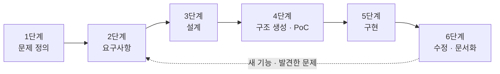
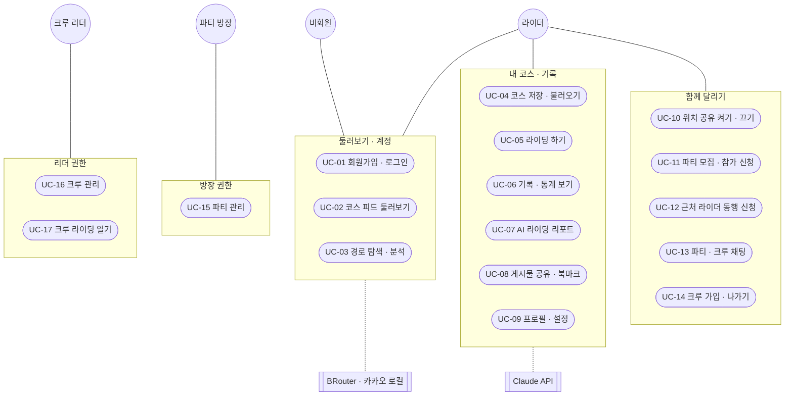
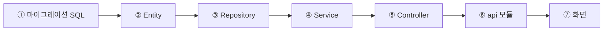

# 페달링크 (Pedal Link)

> 서울 자전거 경로 안내 및 협동 라이딩 웹 플랫폼 — 코스를 만들고, 근처 라이더와 함께 달리고, 기록을 나눈다

| 항목 | 내용 |
|---|---|
| 팀 | 김호성(조장) · 신재원 · 임연수 |
| 지도교수 | 김원일 교수 |
| 개발기간 | 2026. 07 ~ 2026. 11 |
| 기술 스택 | React 19 · Vite · Leaflet / Spring Boot 4 · Java 21 · WebSocket(STOMP) / PostgreSQL 18 + PostGIS / Rocky Linux · Nginx · Cloudflare Tunnel |
| 문서 기준 | `main` 2026-10-17 통합본 · 작성 2026-10-21 |

## 목차
- [개발 단계 한눈에](#개발-단계-한눈에)
- [1단계. 문제 정의](#1단계-문제-정의-problem-definition)
- [2단계. 요구사항](#2단계-요구사항-requirements)
- [3단계. 설계](#3단계-설계-design)
- [4단계. 구조 생성](#4단계-구조-생성-scaffolding-and-poc)
- [5단계. 구현](#5단계-구현-implementation)
- [6단계. 수정 및 문서화](#6단계-수정-및-문서화-revision-and-runbook)
- [부록. 작업계획일정(11주) 대비 실적](#부록-작업계획일정11주-대비-실적)

---

## 개발 단계 한눈에



| 단계 | 하는 일 | 산출물 | 페달링크 결과 |
|---|---|---|---|
| 1. 문제 정의 | 근본 문제를 찾아 목적·범위 결정 | 프로젝트 제안서 · 문제 정의서 · 범위 정의서 | 핵심 문제 4개 → 기능 모듈 9개 |
| 2. 요구사항 | 기능·비기능 요구사항 구체화 | 요구사항 명세 · Use-Case 다이어그램 | 기능 24개 · 비기능 9개 · Use-Case 17개 |
| 3. 설계 | 시스템·데이터·API·화면 설계 | 설계 HTML · 설계 도식 · API 목록 | 테이블 18개 · REST API 68개 · 화면 11개 |
| 4. 구조 생성 | 뼈대·기술 스택·인프라·배포 환경 결정, PoC로 검증 | 프로젝트 골격 · 기술 결정표 · PoC 결과 | PoC 8건 → 운영 서버 구성 확정 |
| 5. 구현 | 보일러플레이트를 반복해 기능 구현 | 소스 코드 · 단위 테스트 | 커밋 79개 · 단위 테스트 61개 통과 |
| 6. 수정 및 문서화 | 통합·점검에서 나온 문제 수정, 운영 절차 정리 | 수정 이력 · Runbook | 보안 5건 · 성능 5건 개선, 운영·배포·장애 대응 Runbook |

> 실제 개발은 기능마다 2~6단계를 반복한 점진적 방식 — 단계별 기간이 서로 겹친다.

---

## 1단계. 문제 정의 (Problem Definition)

근본 문제를 찾아 프로젝트의 목적과 범위를 정한 단계. 산출물은 프로젝트 제안서, 문제 정의서, 프로젝트 범위 정의서.

### 1.1 근본 문제 분석

| # | 겉으로 보이는 문제 | 근본 원인 | 해결 방향 |
|---|---|---|---|
| P1 | 자전거로 길을 찾으면 차도·우회로를 안내받음 | 길안내가 자동차 기준 — 자전거도로를 경로 선택에 쓰지 않음 | 서울 자전거도로 데이터 + 자전거 경로 엔진(BRouter)으로 자전거도로 우선 경로 |
| P2 | 팀 라이딩 중 팀원이 뒤처지거나 길을 잃음 | 달리는 중에는 서로의 위치를 확인할 수단이 없음 — 전화·메신저는 주행 중 쓰기 어려움 | 실시간 위치 공유 + 근접·이탈 자동 알림(지오펜싱) + 파티 채팅 |
| P3 | 함께 달릴 사람을 구하기 어려움 | 지금 근처에서 달리는 사람을 알 방법이 없고, 모임 정보가 흩어져 있음 | 220m 안 라이더 즉석 매칭·파티 모집, 정기 모임용 크루 |
| P4 | 좋은 코스를 찾기 어렵고 기록이 남지 않음 | 코스 공유·주행 기록·커뮤니티가 서로 다른 곳에 나뉘어 있음 | 코스 저장·피드 공유·북마크, 라이딩 기록·통계를 한곳에서 |

**핵심 문제:** 서울의 자전거 이용자는 자전거에 맞는 길을 찾기 어렵고, 여럿이 달릴 때 서로의 위치를 모르며, 함께 달릴 사람과 코스를 찾는 수단이 흩어져 있다.

### 1.2 프로젝트 제안서

| 항목 | 내용 |
|---|---|
| 제안명 | 페달링크 — 서울 자전거 경로 안내 및 협동 라이딩 플랫폼 |
| 제안 배경 | 서울시 자전거 이용자 증가, 자동차 중심 길안내, 팀 라이딩 중 이탈·낙오 위험, 기록·공유 커뮤니티 부재 |
| 핵심 아이디어 | "코스 만들기 → 함께 달리기 → 기록·공유"를 하나의 웹 서비스로 연결 |
| 대상 사용자 | 서울에서 자전거를 타는 개인 라이더, 함께 달리는 팀·동호회 |
| 제공 형태 | 반응형 웹 — PC·휴대폰 브라우저, 설치 없음 |
| 목표 | 자전거 전용 경로 탐색·저장, 파티·위치 공유·지오펜싱으로 협동 라이딩 지원, 실시간 채팅, 피드·크루·매칭으로 커뮤니티 형성 |
| 기대 효과 | 더 안전한 자전거 경로, 팀 라이딩 이탈 방지, 동행 찾기 부담 완화, 오픈소스 스택으로 비용 최소화 |
| 팀 · 기간 | 3명 · 2026. 07 ~ 2026. 11 |

### 1.3 문제 정의서

| 항목 | 내용 |
|---|---|
| 문제 진술 | 자전거 이용자에게 맞는 길안내, 함께 달리는 동안의 위치 확인, 동행·코스 찾기 수단이 없거나 흩어져 있음 |
| 영향을 받는 사람 | 서울 자전거 이용자, 팀 라이딩을 하는 동호회·지인 모임 |
| 영향 | 차도·우회로 주행, 팀 라이딩 중 이탈·낙오, 동행을 못 구해 혼자 주행, 좋은 코스 정보 단절 |
| 기존 방법의 한계 | 일반 지도 앱 — 자동차 기준 경로 / 메신저·전화 — 주행 중 위치 확인 어려움 / 모임 게시판 — 지금 근처에 있는 사람과 바로 연결 불가 |
| 해결 확인 기준 | P1 — 출발·경유·도착을 정하면 자전거 경로와 최단 경로를 함께 계산하고 거리·상승고도·노면 표시<br>P2 — 파티원 위치가 3초마다 갱신, 50m 진입·250m 이탈 시 알림<br>P3 — 220m 안 라이더에게 동행 신청 → 수락하면 파티 자동 생성<br>P4 — 저장한 코스를 피드에 올리고, 라이딩 기록이 통계로 쌓임 |

### 1.4 프로젝트 범위 정의서

**포함 범위 (In Scope)** — 기능 모듈 9개

| 모듈 | 범위 | 해결 문제 |
|---|---|---|
| 회원관리 | 회원가입·로그인, 프로필, 누적 주행 통계 | 공통 |
| 지도·경로 | 자전거 경로 탐색·저장, 지도에 경로·자전거도로 표시 | P1 |
| 파티·협동 라이딩 | 파티 모집·신청·승인, 준비·라이딩 시작·종료 | P2, P3 |
| 실시간 위치 공유 | 위치 공유 켜기·끄기, 지오펜싱 근접·이탈 알림 | P2 |
| 채팅 | 파티 실시간 채팅, 내역 저장 | P2 |
| 피드·둘러보기 | 코스 공유 피드, 좋아요 | P4 |
| 크루(동호회) | 크루 생성·가입, 크루 채팅, 정기 라이딩 | P3 |
| 라이딩 매칭 | 근처 라이더 동행 신청 → 파티 자동 생성 | P3 |
| 배포·운영 | 리눅스 서버 배포, HTTPS 외부 공개 | 공통 |

**제외 범위 (Out of Scope)**
- 서울 밖 지역 — 자전거도로·구 경계 데이터가 서울만 있음
- 네이티브 앱(안드로이드·iOS) — 웹 브라우저로만 제공
- 위치 이력 저장 — 실시간 위치는 보관하지 않음 (개인정보)
- 음성 대화 — 파티 제어판에서 제외 (10-07)

**제약 조건**
- 인원 3명, 학기 일정(2026. 07 ~ 11) 안에 완료
- 비용: 오픈소스·무료 서비스 위주 — AI 분석만 유료 API (10-07 추가)
- 휴대폰 위치(GPS)는 HTTPS에서만 동작 → 외부 공개는 HTTPS 필수
- 운영 서버: 로컬 가상 서버 (Rocky Linux VM)

**가정**
- 근처 기능은 사용자가 위치 공유를 직접 켰을 때만 동작
- 외부 서비스(BRouter · 카카오 로컬 · OpenStreetMap)를 사용할 수 있음

**산출물:** 반응형 웹 애플리케이션, REST API 서버, WebSocket(STOMP) 브로커, PostGIS 공간 DB, Rocky Linux 배포 서버, 개발계획서·설계서·Runbook

**일정 (개발계획서 11주)**

| 주차 | 계획 |
|---|---|
| 1 ~ 3주 | 플로팅 메뉴, 채팅·이미지 첨부, 크루(동호회) 가입·채팅 |
| 4 ~ 5주 | 댓글·좋아요, 지역, 프로필, UI 영상, DB 안정화 |
| 6 ~ 7주 | UI 디자인, 모바일 화면, 협동 라이딩 화면, 실주행·가짜 GPS 테스트 |
| 8주 | AWS 구축·서버 이전, DB 마이그레이션 |
| 9 ~ 11주 | 버그 수정·기능 보완, 학술제 |

계획 대비 실적은 [부록](#부록-작업계획일정11주-대비-실적) 참고.

---

## 2단계. 요구사항 (Requirements)

문제(P1~P4)를 해결하는 기능·비기능 요구사항을 구체화하고, 사용자와 시스템의 상호작용을 Use-Case로 정리한 단계.

### 2.1 액터

| 액터 | 설명 |
|---|---|
| 비회원 | 로그인하지 않은 방문자 — 피드 둘러보기, 지도에서 경로 탐색, 회원가입·로그인 |
| 라이더 | 로그인한 회원 — 코스·라이딩·기록·파티·크루·피드 기능 사용 |
| 파티 방장 | 파티를 만든 라이더 — 참가 수락·거절, 팀원 강퇴, 경로 변경, 라이딩 시작 |
| 크루 리더 | 크루를 만든 라이더 — 가입 방식·가입 수락, 크루 라이딩 열기·인원 체크 |
| 외부 시스템 | BRouter(경로·상승고도), 카카오 로컬(장소 검색), OpenStreetMap(지도), Claude API(AI 분석) |

### 2.2 Use-Case 다이어그램



- 액터와 묶음을 잇는 선 = 그 액터가 묶음 안의 기능을 사용
- 파티 방장·크루 리더는 라이더의 역할이므로 라이더 기능도 모두 사용
- UC-07(AI 리포트)은 UC-06(기록·통계)의 확장(«extend»), UC-17(크루 라이딩)은 UC-05(라이딩 하기)를 포함(«include») — 인원 체크가 끝나면 파티를 만들어 같은 라이딩 화면 사용

### 2.3 Use-Case 명세

| ID | Use-Case | 액터 | 내용 | 해결 문제 |
|---|---|---|---|---|
| UC-01 | 회원가입·로그인 | 비회원 | 이메일·비밀번호로 가입·로그인 | 공통 |
| UC-02 | 코스 피드 둘러보기 | 비회원, 라이더 | 공개된 코스를 20개씩·구별로 보기 | P4 |
| UC-03 | 경로 탐색·분석 | 비회원, 라이더 | 출발·경유·도착 지정 → 자전거·최단 경로, 거리·상승고도·노면 | P1 |
| UC-04 | 코스 저장·불러오기 | 라이더 | 코스 저장, 내 코스·북마크한 코스 불러오기, 삭제 | P1, P4 |
| UC-05 | 라이딩 하기 | 라이더 | 개인·파티 라이딩, 거리·시간 측정, 끝나면 기록 저장 | P2, P4 |
| UC-06 | 기록·통계 보기 | 라이더 | 라이딩 기록 목록, 누적 통계·그래프 | P4 |
| UC-07 | AI 라이딩 리포트 | 라이더 | 통계 숫자로 수준·요약·조언 생성 (UC-06 확장) | P4 |
| UC-08 | 게시물 공유·북마크 | 라이더 | 코스를 게시물로 올리기, 좋아요, 남의 코스 북마크 | P4 |
| UC-09 | 프로필·설정 | 라이더 | 프로필 수정, 이메일·비밀번호 변경 | 공통 |
| UC-10 | 위치 공유 켜기·끄기 | 라이더 | 켜면 근처 기능 사용, 끄면 서버 보관 위치 즉시 삭제 | P2, P3 |
| UC-11 | 파티 모집·참가 신청 | 라이더 | 파티 만들기, 220m 안 파티에 참가 신청, 준비 완료 | P2, P3 |
| UC-12 | 근처 라이더 동행 신청 | 라이더 | 220m 안 라이더에게 신청 → 수락 시 파티 자동 생성, 5분 후 만료 | P3 |
| UC-13 | 파티·크루 채팅 | 라이더 | 실시간 메시지, 내역 저장 | P2 |
| UC-14 | 크루 가입·나가기 | 라이더 | 크루 찾기·가입 신청·나가기, 이번주 라이딩 초대에 응답 | P3 |
| UC-15 | 파티 관리 | 파티 방장 | 참가 수락·거절, 팀원 강퇴, 경로 변경, 라이딩 시작·종료 | P2 |
| UC-16 | 크루 관리 | 크루 리더 | 가입 방식(승인 후·바로·마감) 설정, 가입 수락·거절 | P3 |
| UC-17 | 크루 라이딩 열기 | 크루 리더 | 초대 → 참여 확인 → 당일 220m 인원 체크 → 라이딩 시작 (UC-05 포함) | P3 |

### 2.4 기능 요구사항 (Functional Requirements)

상태: 완료(계획대로) · 변경(내용을 바꿔 구현) · 추가(계획 외 구현) · 미구현 — **완료 16 · 변경 3 · 추가 3 · 미구현 2**

| ID | 모듈 | 요구사항 | 상태 | Use-Case |
|---|---|---|---|---|
| FR-01 | 회원 | 회원가입·로그인·로그아웃, 비밀번호 BCrypt 암호화 | 완료 | UC-01 |
| FR-02 | 회원 | 프로필 설정(소개·자전거·지역·성별·연령), 이메일·비밀번호 변경 | 완료 | UC-09 |
| FR-03 | 회원 | 누적 주행 통계(횟수·거리·시간·상승고도·km당 상승·산악 완주) | 완료 | UC-06 |
| FR-04 | 지도·경로 | 서울 자전거도로 지도 표시 | 완료 | UC-03 |
| FR-05 | 지도·경로 | 출발·경유(최대 100곳)·도착으로 자전거 경로·최단 경로 계산 | 완료 | UC-03 |
| FR-06 | 지도·경로 | 경로 분석 — 거리·상승고도·예상 시간·노면·도로 종류 | 완료 | UC-03 |
| FR-07 | 지도·경로 | 코스 저장·불러오기·삭제(주인만), 코스 지역(구) 자동 분류 | 완료 | UC-04 |
| FR-08 | 라이딩 | 라이딩 시작·종료, 거리·시간 측정, 기록 저장 — 전송 실패 시 재전송 | 완료 | UC-05 |
| FR-09 | 파티 | 파티 모집·참가 신청·수락/거절(방장만), 준비 완료, 함께 라이딩 시작·종료 | 완료 | UC-11, UC-15 |
| FR-10 | 파티 | 남의 파티는 호스트 220m 안 + 양쪽 모두 위치 공유 중일 때만 보기·신청 | 변경 | UC-11 |
| FR-11 | 파티 | 방장 제어판 — 팀원 강퇴, 방장 코스로 경로 변경 | 추가 | UC-15 |
| FR-12 | 위치 | 위치 공유 켜기·끄기 — 끄면 모든 화면에서 전송 중단, 서버 보관분 즉시 삭제 | 완료 | UC-10 |
| FR-13 | 위치 | 3초 주기 위치 갱신, 지오펜싱 50m 진입·250m 이탈 알림 | 완료 | UC-05, UC-10 |
| FR-14 | 채팅 | 파티·크루 실시간 채팅, 내역 저장, 코드 블록 표시 | 완료 | UC-13 |
| FR-15 | 매칭 | 220m 안 라이더 동행 신청·수락/거절, 수락 시 파티 자동 생성, 5분 후 만료 | 완료 | UC-12 |
| FR-16 | 크루 | 크루 생성·가입 신청·나가기, 가입 방식 3종, 수락·거절은 리더만 | 완료 | UC-14, UC-16 |
| FR-17 | 크루 | 정기 라이딩 → "이번주 라이딩 열기"(초대·참여 확인·220m 인원 체크·파티 자동 생성) | 변경 | UC-17 |
| FR-18 | 피드 | 코스 피드(20개씩, 구 필터), 좋아요 | 완료 | UC-02, UC-08 |
| FR-19 | 피드 | 게시물 올리기(문구·태그·사진) — [게시물 올리기]한 코스만 공개 | 변경 | UC-08 |
| FR-20 | 피드 | 북마크 — 남의 코스를 내 코스 목록에 저장 | 추가 | UC-08 |
| FR-21 | 피드 | 댓글·공유 | 미구현 | — |
| FR-22 | AI | AI 라이딩 리포트, 통계 한마디 조언 | 추가 | UC-07 |
| FR-23 | 회원 | 소셜 로그인(구글·네이버) — 버튼만 비활성으로 둠 | 미구현 | UC-01 |
| FR-24 | 배포 | 리눅스 서버 배포, HTTPS 외부 공개 | 완료 | — |

### 2.5 비기능 요구사항 (Non-Functional Requirements)

| ID | 구분 | 요구사항 | 반영 |
|---|---|---|---|
| NFR-01 | 보안 | 비밀번호를 원문으로 저장하지 않음 | BCrypt 해시 |
| NFR-02 | 보안 | 남의 데이터를 바꾸는 요청은 주인·방장·리더만 | 서버에서 주인·방장·리더 확인 (로그인 토큰은 미도입 — [남은 과제](#64-남은-과제)) |
| NFR-03 | 개인정보 | 다른 사람에게 보이는 정보 최소화 | 공개 프로필에서 이메일·위치 공유 설정·로그인 방식 제외 |
| NFR-04 | 개인정보 | 위치 정보 보관 최소화 | 서버 메모리에 15초만 보관, 공유를 끄면 즉시 삭제, DB에 이력 없음 |
| NFR-05 | 개인정보 | 외부 AI로 보내는 정보 최소화 | 이름·이메일 없이 통계 숫자만 전송 |
| NFR-06 | 모바일 | 휴대폰 GPS 사용 | HTTPS로 공개 (Cloudflare Tunnel) |
| NFR-07 | 성능 | 게시물 1만 개에서도 피드가 바로 표시됨 | 20개씩 조회 — 약 0.05초 · 39KB |
| NFR-08 | 가용성 | 외부 서비스 문제가 전체로 번지지 않음 | AI 키가 없거나 호출이 실패하면 AI 기능만 꺼짐 |
| NFR-09 | 접근성 | 움직임에 민감한 사용자·키보드 사용자 배려 | 홈 시연 화면에서 "움직임 줄이기" 설정 존중, 키보드 이동 |

### 2.6 요구사항 변경 이력

개발하면서 협의해 바꾼 요구사항.

| 시점 | 항목 | 처음 안 | 확정 안 | 사유 |
|---|---|---|---|---|
| 06-27 | 대상 지역·기초 데이터 | 인천 자전거도로 임시 데이터 (`testbike` DB) | 서울 자전거도로 2,673구간 (`Pedal_link` DB + PostGIS) | 인천 데이터는 임시용 — 서울 25개 구를 서비스 대상으로 확정 |
| 09-01 | 지오펜싱 진입 반경 | 220m | 50m (이탈 알림 250m) | 근접 알림 기준을 좁힘 (커밋 `35d478f`) |
| 09-21 | 요구사항 문서화 | 작업 기록·메모 | 개발계획서 — 배경·목표·범위·접근방법·11주 일정·기대효과 | 표준 작성 가이드 양식으로 제출용 문서 정리 |
| 09-26 | 남의 파티 보기·신청 범위 | 거리 제한 없음 | 호스트와 220m 안 + 양쪽 모두 위치 공유 중일 때만 | 근처 라이더 중심으로 모집 범위 제한, 220m는 상세 프로필 보기·크루 인원 체크에도 공통 적용 |
| 09-29 | 상승고도 집계 | 탄 코스의 상승고도를 그대로 합산 (GPS 고도 측정도 검토) | 코스 상승고도 × min(1, 탄 거리 ÷ 코스 거리) | 일부만 탄 코스의 과대 집계 방지, GPS 고도는 수직 오차 10~30m·PC 브라우저 미지원으로 제외 |
| 09-26 ~ 10-03 | 게시물 지역 판정 | 카카오 API → 가장 가까운 자전거도로의 구 | 서울 구 경계 폴리곤(`seoul_gu`) 안에 출발점이 있는 구 | 카카오 키가 없어 실패, 최근접 방식은 구 표기 오류(잠실 → 강남구) |
| 10-07 | 피드 공개 기준 | 코스 저장 = 피드 공개 (08-19 설계) | [게시물 올리기]를 한 코스만 공개 (`routes.published_at`) | 북마크 도입으로 저장만 한 코스를 남이 보고 저장할 수 있게 됨 |
| 10-07 | 파티 방장 제어판 | 파티 설정·경로 수정·음성 대화 버튼 (비활성 자리표시) | 팀원 강퇴, 방장 코스로 경로 수정 구현, 음성 대화 삭제 | 요청에 따른 범위 조정 |
| 10-07 | AI 분석 (신규) | 계획에 없음 | AI 라이딩 리포트·통계 한마디 조언 (Claude API) | 쌓인 라이딩 기록 활용 — 유료 API(1회 약 $0.01~0.02 추정)라 "추가 비용 없음" 전제가 바뀜 |

---

## 3단계. 설계 (Design)

설계 자료는 저장소에 있음 — 아래는 요약.

| 자료 | 내용 |
|---|---|
| [설계 HTML](보고서/설계/PedalLink_설계.html) | ER 관계도(테이블 18 · FK 16 · 논리 참조 14) · 데이터 흐름 · 아키텍처 · 워크플로 4탭 (10-21 갱신). GitHub에서는 소스로 보이므로 내려받아 브라우저로 열기 |
| [설계 HTML 원본](보고서/설계/원본/) | 설계 HTML을 다시 만드는 스크립트 · 다이어그램 원본 · 스키마 추출 쿼리 |
| [설계 도식](보고서/팜플렛/설계_도식/) | 시스템 구성 · 라이딩 흐름 · 데이터 구조 (아래 그림 3장) |
| [REST API 목록](<0_v/페달링크 자료 설명/09_REST_API_설계.md>) | 전체 API 명세 |
| [채팅 설계](websocket-chat-plan.md) | WebSocket(STOMP) 채팅 구현 계획 |

### 3.1 시스템 구성


- 지도·경로·장소 검색은 브라우저가 외부 서비스(OpenStreetMap · BRouter · 카카오 로컬)를 직접 호출
- 서버는 Nginx 뒤의 Spring Boot — REST API, STOMP 채팅, 실시간 위치(메모리), AI 분석(Claude 호출)
- 로컬 개발 때는 Nginx 없이 프론트(3000)가 백엔드(8080)를 직접 호출 → 백엔드 CORS 설정으로 허용

### 3.2 라이딩 흐름과 데이터 저장 위치


### 3.3 데이터 설계


- PostgreSQL + PostGIS, 테이블 18개 = 묶음 5개 + 지도 데이터, 모두 `users`를 기준으로 연결
- FK 제약 16개 + 코드에서만 잇는 논리 참조 14개 (숫자 id만 들고 있는 컬럼)
- 실시간 위치는 테이블이 아닌 서버 메모리에 보관 (15초 후 소멸)
- 라이딩 기록에는 코스 id만 저장하고 상승고도는 통계 때 코스와 조인 → 같은 값을 두 곳에 두지 않음
- 스키마 변경은 `DB/migrations/`의 SQL 001~014로 기록, 모두 여러 번 실행해도 안전하게 작성

### 3.4 API 설계

- REST API 68개 (디버그용 1개 제외) — 개발계획서 작성 시점(09-21) 46개에서 기능 추가로 증가
- 실시간 채팅은 STOMP: `/ws` 연결 → `/app/...` 발행 → `/topic/...` 구독
- 실패 응답은 `{ message }` 본문 + 상태 코드(400 입력 오류 · 401 비밀번호 불일치 · 403 권한 없음 · 404 없음 · 409 중복), 화면은 서버 문구를 그대로 표시

<details>
<summary>영역별 API 68개 펼치기</summary>

| 영역 | 경로 | 개수 | 주요 기능 |
|---|---|---|---|
| 인증 | `/api/auth` | 3 | 회원가입, 로그인, 위치 공유 설정 |
| 사용자 | `/api/users` | 5 | 프로필 조회·수정, 공개 프로필, 이메일·비밀번호 변경 |
| 코스 | `/api/routes` | 4 | 저장, 목록(북마크 포함), 상세, 삭제 |
| 피드 | `/api/feed`, `/api/routes/{id}/…` | 6 | 피드 페이지·사이드바 집계, 게시물 올리기, 좋아요, 북마크 |
| 자전거도로 | `/api/cycleways` | 1 | 서울 자전거도로 GeoJSON |
| 실시간 위치 | `/api/locations` | 3 | 위치 보고·조회·삭제 |
| 파티 | `/api/parties` | 14 | 모집·신청·승인/거절·준비·라이딩 시작/종료·강퇴·경로 변경 |
| 매칭 | `/api/matches` | 5 | 동행 신청·수락·거절, 보낸/받은 신청 |
| 크루 | `/api/crews` | 8 | 생성·조회·가입·나가기·설정·가입 수락/거절 |
| 크루 라이딩 | `/api/crews/{id}/rides`, `/api/crew-rides` | 9 | 열기·참여 응답·인원 체크·시작·취소 |
| 라이딩 기록 | `/api/ride-records` | 7 | 기록 저장·목록·통계, AI 리포트, 한마디 조언 |
| 상태 묶음 | `/api/me/status` | 1 | 파티 도크가 5초마다 확인하는 상태를 한 번에 |
| 채팅 기록 | `/api/chat`, `/api/crew-chat` | 2 | 파티·크루 채팅 내역 |

</details>

### 3.5 화면 설계

| 경로 | 화면 | 주요 기능 |
|---|---|---|
| `/` | 홈 | 서비스 소개, 기능 시연 애니메이션·영상 |
| `/map` | 지도 | 경로 만들기(출발·경유·도착), 경로 분석·저장, 위치 공유, 라이딩 |
| `/party` | 파티 | 근처 파티 모집·신청, 대기방 |
| `/crew` | 크루 | 크루 찾기·가입, 크루 채팅, 이번주 라이딩 |
| `/browse` | 둘러보기 | 코스 피드, 좋아요, 북마크, 게시물 올리기 |
| `/chat` | 채팅 | 파티 채팅 |
| `/profile` | 프로필 | 프로필 설정, 주행 통계·그래프, AI 리포트, 라이딩 기록 |
| `/settings` | 설정 | 이메일·비밀번호 변경, 위치 공유 스위치 |
| `/login`, `/signup` | 로그인·회원가입 | 이메일 계정 |
| `/home-old` | 이전 홈 | 개편 전 홈 보존 |

- 어느 화면에서든 뜨는 공통 요소: 파티 도크(파티 상태·미니 채팅·근처 라이더), 라이딩 화면(파티·개인), 상세 프로필 창, 모바일 메뉴
- 라우팅은 React Router 없이 `window.history`로 직접 구현 (`App.jsx`)

### 3.6 핵심 설계 결정

| 결정 | 내용 | 이유 |
|---|---|---|
| 실시간 위치는 메모리에 | 3초마다 오는 위치를 서버 메모리에 15초만 보관, 공유를 끄면 즉시 삭제 | 금방 낡는 데이터라 DB에 쓸 필요 없음, 개인정보 보관 최소화 |
| 지역 판정은 PostGIS | 코스 출발점이 들어 있는 구를 `seoul_gu` 경계 폴리곤으로 판정(`ST_Covers`) | 외부 API 없이 DB 안에서 정확히 판정 |
| 근처 판정은 메모리 거리 계산 | 메모리의 최신 위치끼리 하버사인 거리로 220m 안인지 판정 | 요청마다 DB를 조회하지 않음, 기준값은 서버 상수 하나로 관리 |
| 상승고도는 탄 만큼만 | 코스 상승고도 × min(1, 탄 거리 ÷ 코스 거리) | 일부만 탄 코스가 통계를 부풀리지 않게 |
| AI에는 숫자만 | 이름·이메일 없이 통계 숫자만 보내고, 기록이 바뀔 때만 다시 호출해 결과 저장 | 개인정보 보호, 호출 비용 절감 |
| 크루 라이딩은 파티 재사용 | 인원 체크가 끝나면 파티를 자동 생성해 라이딩 화면·위치·기록을 그대로 사용 | 같은 기능을 두 번 만들지 않음 |
| 채팅 테이블 분리 | 파티 채팅 `chat_messages`, 크루 채팅 `crew_chat_messages` | 방 번호(파티 id·크루 id) 충돌 방지 |
| 서버 호출 창구 하나 | 화면의 모든 API 호출은 `api/client.js`를 거침 | 서버 주소·오류 처리를 한 곳에서 관리 |

---

## 4단계. 구조 생성 (Scaffolding and PoC)

소프트웨어의 뼈대, 기술 스택, 인프라·배포 환경을 정하고 PoC(기술 검증)로 확인한 단계.

### 4.1 프로젝트 뼈대

```
Pedal_link/
├── my-app-front/              React 19 + Vite — 화면
│   └── src/
│       ├── pages/             화면 11개 (지도·파티·크루·피드·프로필 …)
│       ├── components/        파티 도크·라이딩 화면·모달 등 재사용 UI
│       ├── api/               서버 호출 모음 — 모두 client.js 를 거침
│       ├── hooks/             채팅(STOMP)·위치 공유·라이딩
│       └── utils/             지도·거리·기록 재전송 큐
├── my-app-backend/            Spring Boot 4 — API 서버
│   └── src/main/java/com/example/demo/
│       ├── controller/        REST·STOMP 진입점 14개
│       ├── service/           업무 로직
│       ├── repository/        JPA 쿼리
│       ├── entity/            테이블 매핑 16개
│       ├── dto/               요청·응답 형태
│       └── Config/            보안(BCrypt)·WebSocket 설정
├── DB/
│   ├── migrations/            스키마 변경 SQL 001~014
│   └── dump-*.sql             DB 덤프 (복원용)
├── 0_v/페달링크 자료 설명/      기술·기능·운영 문서 25편
├── 보고서/                     개발계획서·설계·팜플렛·인수인계
└── SETUP.md                   개발 환경 세팅 가이드
```

### 4.2 기술 스택 결정

| 영역 | 선택 | 선택 이유 |
|---|---|---|
| 화면 | React 19 + Vite | 05-09 CRA로 시작 → 08-21 Vite로 전환 (CRA는 2025년 공식 지원 종료, Vite는 개발 서버·빌드가 빠름) |
| 지도 | Leaflet + OpenStreetMap | 오픈소스·무료, 키 없이 지도 타일 사용, GeoJSON·선 그리기가 간단 |
| 경로 계산 | BRouter (`trekking` · `shortest`) | 자전거 친화 경로와 최단 경로를 같은 API로 계산, 지형 고도로 상승고도 제공 |
| 장소 검색 | 카카오 로컬 API | 국내 장소명 검색 |
| 서버 | Spring Boot 4.0.6 + Java 21 | REST·WebSocket·JPA·보안을 한 프레임워크에서 |
| 공간 DB | PostgreSQL 18 + PostGIS 3.6 | 경로 선(LineString) 저장, `ST_Covers` 같은 공간 쿼리, GeoJSON을 ogr2ogr로 바로 적재 |
| ORM | Spring Data JPA + Hibernate Spatial | 엔티티에 공간 타입 매핑 |
| 실시간 채팅 | WebSocket + STOMP | 방(파티·크루) 단위 구독·발행, Spring 기본 브로커로 바로 사용 |
| 실시간 위치 | REST 3초 폴링 + 서버 메모리 | 기존 REST 방식만으로 먼저 구현 가능, 3초면 낡는 데이터라 DB 불필요 |
| AI 분석 | Claude API (Anthropic Java SDK) | 통계 숫자를 넣으면 수준·요약·조언을 정해진 형태로 받음 |
| 테스트 | Vitest + Testing Library | Vite 설정을 그대로 공유 |

### 4.3 인프라·배포 환경 결정

환경은 한 번에 정하지 않고 필요가 생길 때마다 바꿨다.

| 단계 | 구성 | 바꾼 이유 |
|---|---|---|
| 1. 로컬 개발 | Windows PC — 프론트 3000, 백엔드 8080, PostgreSQL 5432 | 기본 개발 환경 |
| 2. 휴대폰 시연 (08-18) | 로컬 + Cloudflare 임시 터널 2개(프론트·백엔드), CORS에 터널 주소 허용 | 휴대폰 GPS는 HTTPS에서만 동작 |
| 3. 서버 1차 | Rocky Linux VM에 DB + 백엔드, 프론트는 로컬 | 리눅스 서버 배포 경험 (개발계획서 목표) |
| 4. 서버 전체 (09-25, 현재) | VM에 Nginx + 프론트 정적 파일 + 백엔드 + DB, 터널 1개 | 같은 주소라 CORS·주소 설정 불필요, 발표 당일 점검 3곳 → 1곳 |
| 5. 다음 단계 (계획) | AWS EC2 + RDS, 고정 도메인 | 계획표 8주차, 실행할 때마다 바뀌는 터널 주소 문제 해결 |

**현재 배포 환경**

| 구성 | 내용 |
|---|---|
| OS | Rocky Linux 10 (VM) |
| 웹 서버 | Nginx :80 — 정적 파일 제공, `/api/` · `/ws/` 를 백엔드로 프록시 |
| 백엔드 | Spring Boot JAR — systemd 서비스(부팅 시 자동 시작, 죽으면 5초 뒤 재시작), `ddl-auto=validate` |
| DB | PostgreSQL 18 + PostGIS 3.6 — localhost 전용 |
| 외부 공개 | Cloudflare Tunnel (HTTPS) |
| 방화벽 | 80번만 개방 — 8080 · 5432 외부 차단 |

### 4.4 PoC (기술 검증)

| # | 검증한 것 | 방법 | 결과 |
|---|---|---|---|
| PoC-1 | 서버·DB 연결 | 인천 자전거도로 임시 데이터(`testbike` DB)로 Spring Boot ↔ PostgreSQL 연결 (06-11) | 성공 → 06-27 서울 데이터로 전환 |
| PoC-2 | 공간 데이터 적재·표시 | 서울 자전거도로 GeoJSON 2,673구간 → ogr2ogr → PostGIS → `GET /api/cycleways` → Leaflet | 지도에 서울 전체 자전거도로 표시 |
| PoC-3 | 자전거 경로 계산 | BRouter 두 프로필(`trekking`·`shortest`) 동시 요청, 응답에서 거리·상승고도·노면 파싱 | 자전거 경로·최단 경로 비교, 경로 분석 화면 |
| PoC-4 | 실시간 위치 + 지오펜싱 | "테스트용 핀을 두고 접촉하면 메시지"(07-21 계획) → 실시간 위치 마커(07-24) → 동적 지오펜싱(07-28) | 3초 폴링·메모리 보관 구조 확정, 시뮬레이터(`/geofence-test.html`)로 반복 검증 |
| PoC-5 | 휴대폰 시연 | Cloudflare 임시 터널로 HTTPS 공개 (08-18) | 휴대폰 GPS 동작 확인, CORS 허용 목록을 한 곳으로 모음 |
| PoC-6 | 실시간 채팅 | 단계별 구현 계획서(`websocket-chat-plan.md`) → STOMP 브로커 → DB 저장 (09-03) | 파티 채팅 → 크루 채팅으로 확장 |
| PoC-7 | 리눅스 서버 배포 | Rocky Linux VM에 전체 스택 구축, 주요 경로 5개 검증 (09-25) | 운영 서버 구성 확정 (6단계 Runbook) |
| PoC-8 | AI 분석 연동 | 로컬 가짜 서버로 Claude 호출 흐름 검증 (10-07) | 키가 없으면 AI 기능만 꺼지는 구조 확정 — 실제 호출은 크레딧 충전 후 |

---

## 5단계. 구현 (Implementation)

4단계에서 정한 뼈대 위에, 같은 보일러플레이트(정해진 코드 틀)를 반복해 기능을 추가했다.

### 5.1 보일러플레이트 — 기능 하나를 추가하는 7단계



예시: **피드 북마크** (남의 코스를 내 코스 목록에 저장) — 실제 코드에서 발췌

**① 마이그레이션 SQL** — `DB/migrations/012_route_bookmarks.sql`, 여러 번 실행해도 안전하게 작성
```sql
CREATE TABLE IF NOT EXISTS route_bookmarks (
    id         BIGSERIAL PRIMARY KEY,
    user_id    BIGINT    NOT NULL REFERENCES users (id) ON DELETE CASCADE,
    route_id   BIGINT    NOT NULL REFERENCES routes (id) ON DELETE CASCADE,
    created_at TIMESTAMP NOT NULL DEFAULT now(),
    CONSTRAINT uk_route_bookmarks_user_route UNIQUE (user_id, route_id)
);
CREATE INDEX IF NOT EXISTS idx_route_bookmarks_route ON route_bookmarks (route_id);
```

**② Entity** — 테이블 한 행 = 객체 하나 (`entity/RouteBookmark.java`)
```java
@Entity
@Table(name = "route_bookmarks", uniqueConstraints = {
        @UniqueConstraint(name = "uk_route_bookmarks_user_route", columnNames = {"user_id", "route_id"})
})
@Data
public class RouteBookmark {

    @Id
    @GeneratedValue(strategy = GenerationType.IDENTITY)
    private Long id;

    @Column(name = "user_id", nullable = false)
    private Long userId;

    @Column(name = "route_id", nullable = false)
    private Long routeId;

    @Column(nullable = false)
    private LocalDateTime createdAt = LocalDateTime.now();
}
```

**③ Repository** — 메서드 이름만으로 쿼리 생성 (`repository/RouteBookmarkRepository.java`)
```java
public interface RouteBookmarkRepository extends JpaRepository<RouteBookmark, Long> {

    Optional<RouteBookmark> findByUserIdAndRouteId(Long userId, Long routeId);

    // 내 저장 목록 (최근에 저장한 것부터)
    List<RouteBookmark> findByUserIdOrderByCreatedAtDesc(Long userId);

    // ... 피드 카드의 "저장됨" 표시용 조회, 저장 취소용 삭제 쿼리
}
```

**④ Service** — 업무 규칙과 트랜잭션 (`service/FeedService.java`)
```java
@Service
@RequiredArgsConstructor
public class FeedService {

    private final RouteRepository routeRepository;
    private final RouteBookmarkRepository routeBookmarkRepository;
    // ...

    @Transactional
    public Map<String, Object> toggleBookmark(Long routeId, Long userId) {
        Route route = routeRepository.findById(routeId)
                .orElseThrow(() -> new IllegalArgumentException("경로를 찾을 수 없습니다"));
        if (userId.equals(route.getUserId())) {
            throw new IllegalArgumentException("내 코스는 이미 저장된 경로 목록에 있어요");
        }

        var existing = routeBookmarkRepository.findByUserIdAndRouteId(userId, routeId);
        if (existing.isPresent()) {
            routeBookmarkRepository.delete(existing.get());
            return Map.of("bookmarked", false);
        }
        // 피드에 올리지 않은(저장만 한) 코스는 남이 담을 수 없다
        if (route.getPublishedAt() == null) {
            throw new IllegalArgumentException("피드에 올라온 게시물만 저장할 수 있어요");
        }
        RouteBookmark bookmark = new RouteBookmark();
        bookmark.setUserId(userId);
        bookmark.setRouteId(routeId);
        routeBookmarkRepository.save(bookmark);
        return Map.of("bookmarked", true);
    }
}
```

**⑤ Controller** — 요청을 받아 서비스에 넘기고, 실패는 `{ message }` + 상태 코드로 (`controller/FeedController.java`)
```java
@RestController
@RequestMapping("/api")
@RequiredArgsConstructor
public class FeedController {

    private final FeedService feedService;

    @PostMapping("/routes/{routeId}/bookmark")
    public ResponseEntity<?> toggleBookmark(@PathVariable Long routeId,
                                            @RequestBody Map<String, Long> body) {
        Long userId = body.get("userId");
        if (userId == null) {
            return ResponseEntity.badRequest().body(Map.of("message", "로그인이 필요합니다"));
        }
        try {
            return ResponseEntity.ok(feedService.toggleBookmark(routeId, userId));
        } catch (IllegalArgumentException e) {
            return ResponseEntity.badRequest().body(Map.of("message", e.getMessage()));
        }
    }
}
```

**⑥ api 모듈** — 모든 호출은 `api/client.js` 하나를 거치고, 기능별 파일에서 감싼다
```js
// api/client.js (요약)
const envBase = import.meta.env.VITE_API_BASE;
export const API_BASE = envBase === undefined ? 'http://localhost:8080' : envBase;

async function request(path, { method = 'GET', body } = {}) {
  const options = { method, headers: {} };
  if (body !== undefined) {
    options.body = JSON.stringify(body);
    options.headers['Content-Type'] = 'application/json';
  }
  const res = await fetch(`${API_BASE}${path}`, options);
  if (!res.ok) throw new ApiError(res.status, await res.text().catch(() => ''));
  const raw = await res.text();
  return raw ? JSON.parse(raw) : null;
}

export const api = {
  get: (path, opts) => request(path, { ...opts, method: 'GET' }),
  post: (path, body, opts) => request(path, { ...opts, method: 'POST', body }),
  // put, del ...
};
```
```js
// api/feed.js
export const toggleBookmark = (routeId, userId) =>
  api.post(`/api/routes/${routeId}/bookmark`, { userId });
```

**⑦ 화면** — 화면을 먼저 바꾸고, 서버 응답으로 맞추고, 실패하면 되돌림 (`pages/BrowsePage.jsx`)
```jsx
const handleBookmark = async (routeId) => {
  const before = items;
  setItems((prev) => prev.map((it) => (it.id === routeId ? { ...it, bookmarked: !it.bookmarked } : it)));
  try {
    const res = await toggleBookmark(routeId, user.id);
    setItems((prev) => prev.map((it) => (it.id === routeId ? { ...it, bookmarked: res.bookmarked } : it)));
    showToast(res.bookmarked ? text.browseSavedToast : text.browseUnsavedToast);
  } catch {
    setItems(before);
    showToast(text.browseSaveFailed);
  }
};
```

<details>
<summary>설정 보일러플레이트 펼치기 — DB 연결 · STOMP · CORS</summary>

**`application.properties`** — `.example`을 복사해 쓴다 (실제 파일은 git 제외)
```properties
spring.datasource.url=jdbc:postgresql://localhost:5432/Pedal_link
spring.datasource.username=postgres
spring.datasource.password=YOUR_DB_PASSWORD
# 로컬은 update, 서버는 validate (코드와 DB가 다르면 기동 실패)
spring.jpa.hibernate.ddl-auto=update
# SQL 로그는 필요할 때만: SHOW_SQL=true
spring.jpa.show-sql=${SHOW_SQL:false}
server.compression.enabled=true
# Claude API 키는 my-app-backend/.env 또는 환경변수 ANTHROPIC_API_KEY — 없으면 AI 기능만 꺼짐
spring.config.import=optional:file:./.env[.properties]
anthropic.api-key=${ANTHROPIC_API_KEY:}
```

**STOMP** — `Config/WebSocketConfig.java`
```java
@Override
public void configureMessageBroker(MessageBrokerRegistry registry) {
    registry.enableSimpleBroker("/topic");               // 구독: /topic/chat/{roomId}
    registry.setApplicationDestinationPrefixes("/app");  // 발행: /app/chat/{roomId}/send
}

@Override
public void registerStompEndpoints(StompEndpointRegistry registry) {
    registry.addEndpoint("/ws").setAllowedOriginPatterns("*").withSockJS();
}
```

**CORS** — `WebConfig.java`, 허용 주소는 이 한 곳에서만 관리
```java
registry.addMapping("/**")
        .allowedOriginPatterns("http://localhost:3000", "https://*.trycloudflare.com")
        .allowedMethods("GET", "POST", "PUT", "DELETE", "OPTIONS")
        .allowedHeaders("*")
        .allowCredentials(true);
```

</details>

### 5.2 구현 경과 (git 기록 기준)

팀원별 브랜치: `khs`(김호성) · `sjw`(신재원) · `ys`(임연수)

| 기간 | 주요 구현 | 브랜치 |
|---|---|---|
| 05-09 ~ 06-27 | 저장소 생성, 지도 화면 초안, 서버·DB 연결, 서울 자전거도로 DB 전환·인천 기능 제거 | ys, khs |
| 07-11 ~ 07-28 | 파티(링크) 탭·API 계층, 로그인·회원가입, 경로 저장·삭제, 실시간 현재 위치, 동적 지오펜싱, 위치 공유 설정 | ys, khs |
| 08-11 ~ 08-21 | 라이딩 시작·종료·기록 저장, 파티 백엔드(가짜 데이터 → 실제 API), 둘러보기 피드·좋아요·게시물, 파티 함께 달리기, CRA → Vite 전환, 홈 리디자인 | khs, ys |
| 08-30 ~ 09-05 | 플로팅 메뉴, WebSocket 채팅 서버, 채팅 저장·화면, 파티 대기방(채팅·멤버·제어판·준비 상태), 협동 라이딩 화면, DB 정리 | ys, khs, sjw |
| 09-09 ~ 09-18 | 모바일 메뉴·UI 수정, 개인 라이딩·지오펜스 매칭·프로필, 크루·크루 채팅·가입 관리, 코스 지역·산악 통계·역량 그래프, 근처 라이더 프로필 미리보기 | ys, sjw |
| 09-26 ~ 10-16 | 설정(이메일·비밀번호), 위치 공유 서버 기준 동기화, 상승고도 개선, 경유지, 크루 이번주 라이딩, 성능 최적화, AI 리포트·한마디 조언, 피드 페이지·북마크·게시물 공개, 파티 방장 제어판 | khs |
| 10-03 ~ 10-16 | 1차 버그 수정(라이딩 기록 저장 안정화, 지도 팝업 XSS 방지)과 단위 테스트, 홈 개편(기능 시연 애니메이션·영상), 코드 최적화 | ys |

### 5.3 브랜치·통합 방식

- 팀원별 브랜치에서 개발 → `main`으로 머지
- 머지는 항상 머지 커밋을 남기는 방식(`--no-ff`) — 누가 언제 무엇을 합쳤는지 이력에 남음
- 머지 전 `git merge-tree`로 충돌 여부를 미리 확인
- 충돌은 3-way 비교(공통 조상 포함)로 양쪽 변경을 모두 살려 해결 — 10-17 세 브랜치 최종 통합

<details>
<summary>10-17 통합 충돌 8개 파일 해결 내역 펼치기</summary>

| 파일 | 해결 |
|---|---|
| `MapPage.jsx` | `ys` 구조(라이딩 훅 분리·늦은 응답 무시·저장 스냅샷) + `khs` 경유지·탄 코스 연결·지역·북마크 목록 |
| `RidingRoom.jsx` | `ys` 종료·기록 확정 흐름 + `khs` 강퇴 시 닫기·크루 라이딩 종료 감지 |
| `PersonalRidingRoom.jsx` | 위치 공유 꺼짐 처리 중복 제거(`ys` 유지) + `khs` 핀 → 프로필 |
| `api/crews.js` | `ys` 가짜 데이터 제거 + `khs` 크루 설정 API·리더 id 전달 |
| `leaflet.js`, `rides.js`, `App.jsx`, `PartyDock.jsx` | 양쪽 추가분 합침 |

</details>

### 5.4 단위 테스트

**실행 결과 (2026-10-21, `my-app-front`에서 `npx vitest run`)** — 테스트 파일 13개 · 케이스 61개 전부 통과, 11.4초

| 대상 | 케이스 | 검증 내용 |
|---|---|---|
| `utils/rideRecords` | 17 | 전송 실패 기록의 재전송 큐(5xx·네트워크 오류는 보존, 4xx는 버림), 화면과 도크가 동시에 불러도 파티 기록 한 번만 저장, 새로고침 후 중복 저장 방지 |
| `hooks/useMapRide` | 4 | 라이딩 중 화면을 떠나면 GPS·타이머 해제 후 한 번 저장, 재시작 시 이전 거리 초기화, 거리 0이면 저장 안 함 |
| `components/RidingRoom` | 4 | 재진입 시 거리 이어가기, 방장 종료 실패 시 기록 보류 후 재시도 때 한 번 저장, 위치 공유 꺼짐 안내 |
| `components/PersonalRidingRoom` | 3 | React StrictMode에서도 기록 한 번만 저장, 위치 공유 꺼짐 안내 |
| `utils/leaflet` | 1 | 출발·도착 이름을 지도 팝업에 텍스트로만 넣음 (XSS 방지) |
| 홈 시연 컴포넌트 6개 | 29 | 단계 자동 진행·일시정지, 화면 밖이면 정지, "움직임 줄이기" 설정 존중, 키보드 이동 |
| `App`, `HomeDraftPage` | 3 | 홈 경로(`/`, `/home-old`) 표시, 비로그인 시 로그인·회원가입 링크 |

**백엔드 검증**
- 자동 테스트는 `contextLoads`(스프링 기동 확인) 1개뿐 — 서비스 로직 단위 테스트는 없음
- 대신 기능을 고칠 때마다 API 시나리오를 직접 실행: 백엔드를 8081 포트로 따로 띄우고 임시 테스트 계정으로 요청 → 끝나면 SQL로 정리
  - 10-07 기준 8개 영역 116개 시나리오 통과 (크루 설정 11 · 크루 리더 확인 8 · AI 리포트 21 · 한마디 조언 13 · 북마크 15 · 게시물 공개 10 · 파티 강퇴·경로 27 · 크루 라이딩 종료 11)
- 브라우저 E2E: Playwright + Edge(headless), 위치는 `navigator.geolocation`을 가짜로 바꿔 이동 재현

### 5.5 구현 규모 (10-17 `main` 기준)

| 구분 | 규모 |
|---|---|
| 백엔드 | Java 89개 파일 · 약 5,260줄 — 컨트롤러 14, 서비스 11, 엔티티 16, 리포지토리 16 |
| 프론트엔드 | JS/JSX 77개 파일 · 약 12,330줄(테스트 제외), CSS 약 9,300줄 — 화면 11, API 모듈 13, 훅 3 |
| 테스트 | 프론트 13개 파일 · 61개 케이스, 백엔드 1개 |
| DB | 테이블 18개, 마이그레이션 SQL 14개 |
| 이력 | 커밋 79개 (05-09 ~ 10-17) |

---

## 6단계. 수정 및 문서화 (Revision and Runbook)

통합·점검에서 나온 문제를 고치고, 누구나 같은 절차로 실행·배포·복구할 수 있게 Runbook으로 정리한 단계.

### 6.1 수정 이력

**통합·점검에서 발견한 문제**

| 시점 | 문제 | 원인 | 수정·재발 방지 |
|---|---|---|---|
| 07-21 | 로그인 관련 5개 파일 충돌 | `ys` 브랜치가 실제 API 연동 전의 가짜 로그인 초안 | 실제 연동인 `main` 채택 |
| 09-04 | 앱 전체가 흰 화면 | 채팅 커밋을 받은 뒤 `npm install`을 하지 않아 `@stomp/stompjs` 없음 | 설치 후 복구, "pull 뒤 `npm install` 필수" 규칙화 |
| 09-04 | `/api/parties` 500 오류 | `party_members.ready`(boolean NOT NULL)를 `ddl-auto=update`가 만들지 못함 | 마이그레이션 002, "원시 타입 컬럼은 DEFAULT를 넣은 SQL로 추가" 규칙화 |
| 09-04 | 코드와 DB 상태 불일치 | git 이력만 되돌리고 DB는 앞선 상태로 남음 | 차이를 문서화, `validate` 전환 때 주의사항으로 기록 |
| 09-29 | 통계·기록 목록 500 오류 | 상승고도가 없는(null) 옛 코스를 탄 기록에서 오류 | null 처리 |
| 10-07 | 일부 코스 상세 500 오류 | 최단 경로가 없는 코스 | 수정 |
| 10-07 | 크루 라이딩 종료 후 새로고침하면 라이딩 화면이 다시 뜸 | 종료해도 연결된 파티가 끝나지 않은 상태로 남음 | 크루 라이딩 파티는 종료 처리, 마이그레이션 014로 남은 데이터 정리 |
| 10-07 | 모바일에서 가로로 15px 넘침 | 기록 한 줄의 정보 배치 | 줄 배치 변경 |
| 10-17 | 세 브랜치 통합 시 8개 파일 충돌 | 같은 화면을 양쪽에서 수정 | 3-way 머지로 양쪽 기능 유지 |

**보안 점검**

| 항목 | 발견된 문제 | 조치 |
|---|---|---|
| 경로 삭제 | id만 알면 남의 코스도 삭제 | 10-07 서버에서 주인 확인 |
| 파티 수락·거절 | 누구나 API로 처리 가능 | 10-07 방장만 허용 (그 외 403) |
| 크루 가입 수락·거절 | 누구나 처리 가능, 거절 API로 기존 멤버를 내보낼 수 있음 | 10-07 리더 확인 + 대기 중인 신청만 처리 |
| 피드 공개 범위 | 저장만 한 코스도 피드에 노출 | 10-07 [게시물 올리기]한 코스만 공개 |
| 서버 로그 | 오류 메시지에 API 키가 찍힘 | 키 값은 로그에서 제외 |
| 인증 구조 | 로그인 토큰이 없어 요청의 사용자 id를 그대로 믿음 | 미해결 — 세션·JWT 도입 필요 |
| 사용자 조회 | `GET /api/users/{id}`가 누구에게나 이메일 반환 | 미해결 — 다른 사람 화면은 이메일 없는 공개 프로필 API 사용 중 |

**성능 개선**

| 항목 | 개선 전 | 개선 후 |
|---|---|---|
| 피드 조회 (게시물 1만 개) | 전체를 한 번에 — 2.8초 · 23.8MB | 20개씩 — 약 0.05초 · 39KB |
| 자전거도로 `/api/cycleways` | 요청마다 생성 — 80~98ms · 1MB | 한 번 만들어 재사용 + gzip — 6ms · 195KB |
| 파티 목록 (파티 20개) | 쿼리 24번 | 쿼리 2번 |
| 파티 도크 상태 확인 (5초 주기) | 요청 3개 | 요청 1개 (`/api/me/status`) |
| DB 조회 | — | 조회 인덱스 16개 추가, 중복 제약 정리 (마이그레이션 008) |

**유지보수 유형별 정리**

| 유형 | 사례 |
|---|---|
| 수정 (결함 고치기) | 위 "발견한 문제" 표의 500 오류·화면 오류들 |
| 적응 (환경 변화 대응) | Java 21·26 호환(07-21), 터널 공개용 CORS 정리(08-18), CRA → Vite 전환(08-21), 프론트까지 서버에 올리는 구성 변경(09-25) |
| 완전화 (성능·기능 개선) | 피드 페이지 조회, 자전거도로 응답 재사용·gzip, 인덱스 16개, 라이딩 기록 10개씩 페이지 |
| 예방 (문제 미리 막기) | 안 쓰는 테이블 6개·죽은 코드 정리(011), 권한 검사 추가, 로그에서 API 키 제거, 운영 문서 정비 |

### 6.2 Runbook

#### A. 로컬 개발 환경 실행 (Windows · PowerShell)

필요한 것: JDK 21, Node.js, PostgreSQL 18 + PostGIS 3.6 — 설치 방법은 [SETUP.md](SETUP.md)

```powershell
# 1) DB 만들기 → 최신 덤프(09-30) 복원 → 마이그레이션 001~014 순서대로 (모두 여러 번 실행해도 안전)
$env:PGPASSWORD = "<DB 비밀번호>"
$env:PGCLIENTENCODING = "UTF8"
createdb -U postgres Pedal_link
psql -U postgres -d Pedal_link -c "CREATE EXTENSION IF NOT EXISTS postgis;"
psql -U postgres -d Pedal_link -f DB\dump-20260930-1529.sql
Get-ChildItem DB\migrations\*.sql | Sort-Object Name | ForEach-Object { psql -U postgres -d Pedal_link -v ON_ERROR_STOP=1 -f $_.FullName }

# 2) 백엔드 — http://localhost:8080
cd my-app-backend
Copy-Item src\main\resources\application.properties.example src\main\resources\application.properties   # 처음 한 번, DB 비밀번호 수정
$env:JAVA_HOME = "<JDK 21 설치 경로>"
.\gradlew bootRun

# 3) 프론트 — http://localhost:3000 (포트 고정: 백엔드 CORS가 3000만 허용)
cd my-app-front
npm install
npm run dev
```

- AI 기능(선택): `my-app-backend/.env`에 `ANTHROPIC_API_KEY=...` — 없으면 AI 기능만 꺼짐
- 장소 검색(선택): `my-app-front/.env.local`에 `VITE_KAKAO_API_KEY=<카카오 REST API 키>` — 없으면 장소 검색만 안 됨
- `.env`·`.env.local`은 git 제외 — 키를 커밋하지 말 것

#### B. 서버 켜기 · 끄기 · 점검 (Rocky Linux VM)

```bash
# 상태 — active 3줄이면 정상, 5432는 127.0.0.1 에만 열려 있어야 함
sudo systemctl is-active postgresql-18 pedallink nginx
sudo ss -tlnp | grep -E ':80|:8080|:5432'

# 켜기 — 서비스 3개는 부팅 때 자동 시작, 터널만 직접 실행
nohup cloudflared tunnel --url http://localhost:80 > ~/tunnel.log 2>&1 &
sleep 15
grep -o "https://[a-z-]*\.trycloudflare\.com" ~/tunnel.log | head -1   # 접속 주소 (실행할 때마다 바뀜)

# 끄기 — 백엔드는 pkill 금지 (자동 재시작됨), 반드시 systemctl
pkill -f "cloudflared tunnel"
sudo systemctl stop pedallink nginx postgresql-18

# 로그
sudo journalctl -u pedallink -n 50 --no-pager
sudo tail -30 /var/log/nginx/error.log
```

#### C. 배포 — 고친 코드를 서버에 올리기

| 바뀐 것 | 빌드 (Windows) | 서버 반영 | 재시작 |
|---|---|---|---|
| 프론트 | `npm run build` | 정적 파일 복사 + `restorecon` | 불필요 |
| 백엔드 | `.\gradlew bootJar` | 다른 이름으로 전송 → 정지 후 교체 | 필요 |
| 엔티티(스키마) | 백엔드와 같음 | + 마이그레이션 SQL 실행 | 필요 |
| Nginx 설정 | — | `sudo nginx -t` 검사 후 `reload` | 무중단 |

```powershell
# [Windows] 배포 전 커밋 → 빌드 → 전송
scp -r my-app-front\build\* <계정>@<VM주소>:~/front/
scp my-app-backend\build\libs\my-app-backend-0.0.1-SNAPSHOT.jar <계정>@<VM주소>:~/pedallink-new.jar
```

```bash
# [VM] 백업 → 정지 → 교체 → 시작
cp ~/pedallink.jar ~/pedallink-prev.jar
sudo -u postgres pg_dump -d Pedal_link -F p --no-owner --no-privileges > ~/backup-$(date +%Y%m%d-%H%M).sql
sudo systemctl stop pedallink
mv ~/pedallink-new.jar ~/pedallink.jar
sudo cp -r ~/front/* /var/www/pedallink/ && sudo restorecon -Rv /var/www/pedallink
sudo systemctl start pedallink
sudo systemctl status pedallink --no-pager | grep Active   # 방금 시각이면 성공
```

- 돌아가는 중에 JAR을 덮어쓰지 않는다 — `NoClassDefFoundError`가 남
- 크루·파티 수락 API처럼 요청 형식이 바뀐 변경은 프론트와 백엔드를 같이 올린다

#### D. 롤백

```bash
# 백엔드 — 직전 JAR로
sudo systemctl stop pedallink
cp ~/pedallink-prev.jar ~/pedallink.jar
sudo systemctl start pedallink

# 프론트 — 배포 전에 sudo cp -r /var/www/pedallink /var/www/pedallink-prev 로 떠 둔 사본으로
sudo rm -rf /var/www/pedallink && sudo mv /var/www/pedallink-prev /var/www/pedallink
sudo restorecon -Rv /var/www/pedallink
```

- DB는 자동 롤백이 안 됨 → 스키마를 바꾸기 전 `pg_dump` 백업으로 복원

#### E. DB 스키마 변경

- 새 변경은 `DB/migrations/0NN_설명.sql`로 남긴다 — `IF NOT EXISTS` 등으로 여러 번 실행해도 안전하게
- 원시 타입(boolean·int) 컬럼은 `ddl-auto`가 만들지 못함 → `ADD COLUMN IF NOT EXISTS ... DEFAULT ...` SQL로 추가
- 서버는 `ddl-auto=validate` — 마이그레이션 없이 JAR만 올리면 기동 실패 (의도된 안전장치)

```bash
# [VM] 순서대로 적용, 하나라도 실패하면 멈춤
for f in 0NN_첫번째 0NN_두번째; do
  sudo -u postgres psql -d Pedal_link -v ON_ERROR_STOP=1 -f ~/$f.sql || break
done
```

<details>
<summary>마이그레이션 001~014 목록 펼치기</summary>

| 파일 | 내용 | 서버 적용 |
|---|---|---|
| 001 ~ 004 | 채팅 테이블, 파티 준비 상태, 예전 로그인 컬럼 등 죽은 스키마 정리, 중복 컬럼 제거 | — |
| 005 | 서울 구 경계(`seoul_gu`) + 기존 코스 지역 채우기 | 권장 |
| 006 | 코스 경유지 (`routes.waypoints`) | 필수 |
| 007 | 크루 라이딩 컬럼·테이블 | 필수 |
| 008 | 조회 인덱스 16개, 중복 제약 정리 | 권장 |
| 009 | AI 리포트 저장 (`ride_insights`) | 필수 |
| 010 | 한마디 조언 저장 (`ride_tips`) | 필수 |
| 011 | 안 쓰는 테이블 6개 삭제 | 선택 |
| 012 | 피드 북마크 (`route_bookmarks`) | 필수 |
| 013 | 게시물 공개 시각 (`routes.published_at`) | 필수 |
| 014 | 멈춘 크루 라이딩 파티 정리 (데이터만) | 권장 |

</details>

#### F. 장애 대응

| 증상 | 원인 | 조치 |
|---|---|---|
| 화면 403 Forbidden | SELinux 라벨 | `sudo restorecon -Rv /var/www/pedallink` |
| 502 Bad Gateway | 백엔드 꺼짐 또는 SELinux 차단 | `sudo systemctl status pedallink`, `sudo setsebool -P httpd_can_network_connect 1` |
| API만 실패 | `proxy_pass` 끝에 슬래시 | `proxy_pass http://127.0.0.1:8080;` (끝 슬래시 없이) |
| 채팅만 안 됨 | WebSocket 업그레이드 헤더 누락 | `/ws/`에 `proxy_http_version 1.1`, `Upgrade`, `Connection "upgrade"` |
| 터널 주소가 530 | 터널 끊김 | 터널 다시 실행 — 새 주소가 나옴 |
| 백엔드가 계속 재시작 | DB 비밀번호 불일치, 스키마 불일치(`validate`), JAR 경로 오류 | `sudo journalctl -u pedallink -n 50 --no-pager` 메시지로 판단 |
| (로컬) 화면은 뜨는데 API가 전부 실패 | `.env.local`이 죽은 터널 주소, 또는 수정 후 Vite 재시작 안 함 | `VITE_API_BASE` 확인 후 Vite 재시작 |
| (로컬) 앱 전체가 흰 화면 | pull 뒤 `npm install`을 안 함 | `npm install` |
| (로컬) 특정 기능만 500 | `ddl-auto=update`가 컬럼 생성에 실패하고 WARN만 남김 | 로그에서 `Error executing DDL` 검색 → 마이그레이션 SQL로 추가 |
| 휴대폰에서 위치 기능만 안 됨 | HTTP라 브라우저가 GPS 차단 | HTTPS(터널) 주소로 접속 |

#### G. 발표 당일 체크리스트

- [ ] 서비스 3개 `active`, `curl -I http://localhost/` · `curl http://localhost/api/crews` 응답
- [ ] 터널 주소가 PC 브라우저에서 열림
- [ ] 로그인 → 경로 저장 → 목록 조회
- [ ] 파티 생성 → 참가 신청 → 승인
- [ ] 크루 만들기 → 크루 채팅
- [ ] 휴대폰에서 GPS 위치가 잡힘 (PC는 GPS가 없어 IP로 추정 — 수 km 오차)
- [ ] 지오펜싱 시뮬레이터 `/geofence-test.html` 동작

### 6.3 문서 목록

| 문서 | 언제 보나 |
|---|---|
| [SETUP.md](SETUP.md) | 처음 개발 환경을 만들 때 |
| [17 서버 구축](<0_v/페달링크 자료 설명/17_로키_VM_서버_구축.md>) | 서버를 처음부터 만들 때 |
| [22 서버 운영 가이드](<0_v/페달링크 자료 설명/22_서버_운영_가이드.md>) | 서버를 켜고 끄고 점검할 때 |
| [23 배포·업데이트 가이드](<0_v/페달링크 자료 설명/23_배포_업데이트_가이드.md>) | 고친 코드를 서버에 올리고 되돌릴 때 |
| [24](<0_v/페달링크 자료 설명/24_최근_업데이트_0926_1003.md>) · [25 최근 업데이트](<0_v/페달링크 자료 설명/25_최근_업데이트_1007.md>) | 09-26 이후 변경과 마이그레이션을 확인할 때 |
| [00 문서 목록](<0_v/페달링크 자료 설명/00_INDEX.md>) | 기술·기능별 구현 해설 25편을 찾을 때 |
| [인수인계·유지보수](보고서/인수인계_유지보수.html) | 실행·수정·배포 요약과 실제로 겪은 함정을 볼 때 |
| [브랜치 현황](보고서/git-flow.html) | 브랜치 상태와 머지 순서를 볼 때 |
| [개발계획서](보고서/페달링크_개발계획서.docx) | 제출용 계획서 |

### 6.4 남은 과제

| 순위 | 과제 | 내용 |
|---|---|---|
| 1 | 10-17 통합본 서버 반영 | 서버 반영 기록이 없음 → 서버 스키마부터 확인, 백업 후 마이그레이션 005~014 → JAR·프론트 동시 교체 |
| 2 | 로그인 인증 도입 | 세션 또는 JWT로 서버가 요청자를 직접 확인, `GET /api/users/{id}` 이메일 노출도 함께 정리 |
| 3 | 스키마 관리 자동화 | Flyway 도입, 로컬도 `ddl-auto=validate` → 코드·DB 불일치를 기동 시점에 발견 |
| 4 | 백엔드 자동 테스트 | 서비스 로직 단위 테스트 작성, API 시나리오·E2E 스크립트를 저장소에 보관해 회귀 테스트로 재사용 |
| 5 | 고정 접속 주소 | 이름 있는 Cloudflare 터널 또는 도메인 — 지금은 실행할 때마다 주소가 바뀌어 미리 공유 불가 |
| 6 | AI 기능 실제 가동 | 10-07 기준 Anthropic 크레딧 부족으로 실제 호출 실패 → 충전, 보안상 API 키 교체 |
| 7 | 설정 예시 파일 갱신 | `application.properties.example`에 SQL 로그 스위치·gzip·`.env`·Claude 설정이 빠져 있음 |
| 8 | 미구현 기능 | 피드 댓글·공유, 게시물 내리기, 소셜 로그인, 크루 리더 넘기기 |
| 9 | AWS 이전 (계획표 8주차) | EC2 + RDS 구성, 서버를 여러 대로 늘리면 메모리 위치 보관을 Redis 등으로 옮겨야 함 |

---

## 부록. 작업계획일정(11주) 대비 실적

<details>
<summary>개발계획서 작업계획일정표 항목별 실적 펼치기</summary>

| 주차 | 계획 항목 | 실적 |
|---|---|---|
| 1 | 플로팅 버튼 구현 | 완료 (09-01) |
| 2 | 백엔드 채팅방·소셜 서비스, 채팅 페이지 | 채팅 서버·화면 완료 (09-03) |
| 2 | 이미지·첨부 기능 | 게시물 사진 첨부로 구현, 채팅 첨부는 미구현 |
| 3 | 그룹 가입 페이지, 동호회(정기 링크) 채팅·만들기·가입 | 크루 생성·가입·채팅 완료 (09-14) |
| 4 | 댓글·좋아요 백엔드 | 좋아요 완료, 댓글 미구현 |
| 4 | 회원가입 시 지역 명시 | 프로필 설정의 지역 항목으로 반영 (09-14) |
| 5 | UI 영상 제작 | 홈 기능 시연 영상·애니메이션 (10-16) |
| 5 | 개인 프로필 지역·DB 테이블 | 완료 (09-14) |
| 5 | DB 구현화 안정 | 마이그레이션·인덱스 정비 (003 ~ 014), Flyway는 미도입 |
| 6 | UI 디자인·기본 폼 | 완료 |
| 7 | 웹페이지 모바일 변환 | 모바일 메뉴(09-09)·모바일 레이아웃 수정 |
| 7 | 협동 라이딩 화면 | 완료 — 파티·크루·개인 라이딩 화면 |
| 7 | QA 자전거 탑승 테스트 | 수행 기록 없음 |
| 7 | 테스트 (가짜 GPS) | 지오펜싱 시뮬레이터, 가짜 위치 E2E로 수행 |
| 8 | AWS 구축 및 서버 이전 | 로컬 Rocky Linux VM 구축(09-25), AWS 이전은 미진행 |
| 8 | 데이터베이스 마이그레이션 | VM으로 DB 이전 완료(09-25), 이후 변경분 서버 반영은 확인 필요 |
| 9 ~ 11 | 버그 수정·기능 보완·마무리 | 진행 중 — 10-03 1차 버그 수정, 10-17 통합 |
| 11 | 학술제 준비 및 참여 | 팜플렛 단면(10-04)·양면(10-16) 완료 |

</details>

---

*2026-10-21 작성 · 저장소 코드, 문서, git 이력, 테스트 실행 결과를 근거로 정리*
